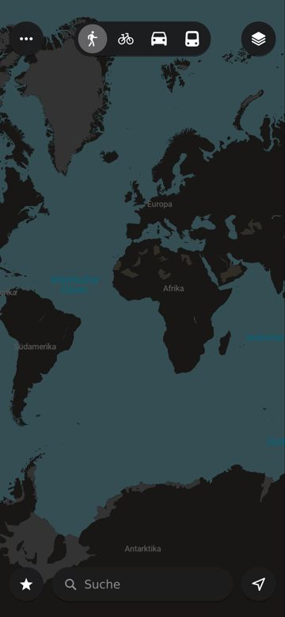
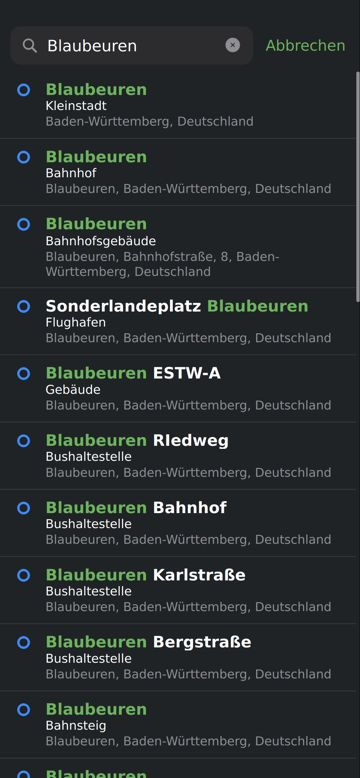
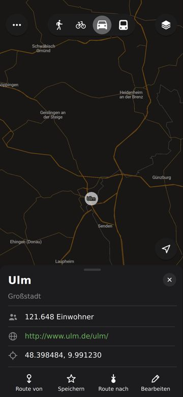
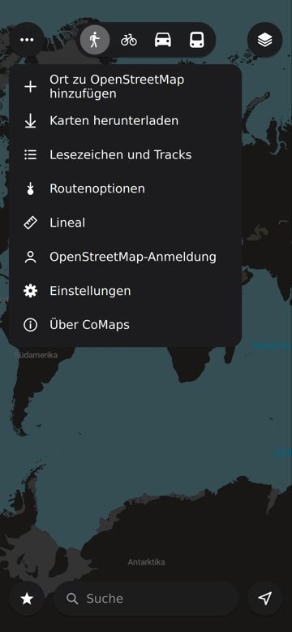
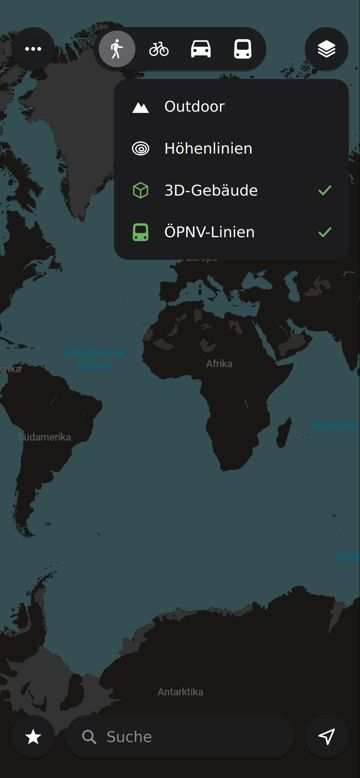
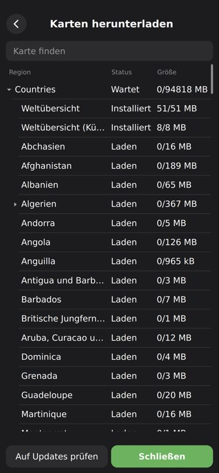

<p align="center">
  
</p>

# ut-sapmoc – Offline-Karten für Ubuntu Touch

**ut-sapmoc** bringt Offline-Karten, Suche und Navigation auf Basis von OpenStreetMap als
Click-Paket auf **Ubuntu Touch** – mit einer Handy-Oberfläche im Stil gängiger iPhone-Karten-Apps.

ut-sapmoc ist ein inoffizieller Port und basiert auf dem Open-Source-Projekt
[CoMaps](https://codeberg.org/comaps/comaps) (Apache-2.0, Fork von Organic Maps). Es ist kein
offizielles Produkt des CoMaps-Projekts und steht in keiner Verbindung zu ihm.

<p align="center">
  
  
  
</p>
<p align="center">
  
  
  
</p>

> **Status:** läuft auf Ubuntu Touch **26.04** (getestet auf einem Poco X3 Pro) und nutzt das
> Qt 6.10 des Systems. Ältere Versionen reichen nicht aus, siehe unten.

## Schnellstart

```bash
./build.sh ci                # auf GitHub bauen lassen (~15 min), Click nach build/ laden
./build.sh phone             # per USB/adb auf dem Handy installieren und starten
./build.sh release 0.1.0     # Release-Build mit sauberer Version (z. B. für den OpenStore)
```

Details zu `build.sh` und zum lokalen Build unter [Bauen](#bauen).

## Warum Ubuntu Touch 26.04?

CoMaps (Stand: master) verlangt Qt 6, C++23, CMake ≥ 3.22.1 und FreeType ≥ 2.13.1. Das deckt
erst Ubuntu 24.04 ab; der **OpenStore** nimmt aber nur Apps an, die das Qt des jeweiligen
Frameworks nutzen: Qt 5.15 für 24.04 und **Qt 6.10 für 26.04** (geprüft von
`click-reviewers-tools`). Ein mitgebrachtes Qt 6.4 wird abgelehnt.

Deshalb wird ut-sapmoc in einem Ubuntu-26.04-Container gegen das Qt aus dem UBports-Repository
gebaut (dieselbe Qt-6.10.2-Version wie auf dem Handy) und nutzt zur Laufzeit das Qt des Systems
samt dessen Plugins: Wayland, Maliit-Bildschirmtastatur und die Standortquelle „lomiri“.
Gebündelt werden nur Bibliotheken, die das Handy nicht hat (z. B. Qt6OpenGLWidgets, Pico TTS).

## Ubuntu-Touch-Anpassungen (patches/)

CoMaps bringt nur ein Qt-Widgets-Desktop-Frontend mit. `patches/0001-ut-integration-theme-language.patch`
ergänzt es für Ubuntu Touch (neue Datei `qt/ut_integration.{hpp,cpp}`):

- **Darstellung (Darkmode):** In *Preferences → Appearance* gibt es „Like the phone“, „Light“ und „Dark“.
  Die Einstellung gilt für die Bedienoberfläche (Fusion-Stil mit heller oder dunkler Palette) und für
  den Kartenstil. „Like the phone“ liest das Lomiri-Theme aus
  `~/.config/lomiri-ui-toolkit/theme.ini` (z. B. SuruDark) und schaltet live mit, wenn du es in den
  Systemeinstellungen umstellst. Das ersetzt den reinen Karten-Schalter „Map Appearance“ von CoMaps.
- **Sprache:** In *Preferences → Language (after restart)* wählst du „Like the phone“ oder eine
  feste Sprache. Sie bestimmt die CoMaps-Texte (Suche und Kategorien, Ortstypen, Routing-Hinweise,
  Ländernamen) und wird beim nächsten Start übernommen. Die Beschriftungen der Desktop-Oberfläche
  selbst übersetzt CoMaps nicht; die Handy-Oberfläche (siehe unten) bringt eigene deutsche und
  englische Texte mit. Die Sprache der **Kartenbeschriftung**
  stellst du weiterhin unter „Map Language“ ein.
- Die Wayland-App-ID wird auf `$APP_ID` gesetzt, damit Lomiri das Fenster der App zuordnet.

Beide Einstellungen liegen in `settings.ini` im Datenordner (`~/.local/share/ut-sapmoc/`).

### Handy-Oberfläche (`patches/0006-ut-mobile-ui-ios-style.patch`)

Die Desktop-Werkzeugleiste und das Menü passen nicht auf ein Handy. Stattdessen liegt die Karte
bildschirmfüllend unter runden, schwebenden Bedienelementen:

- oben: Menü (⋯), Verkehrsmittel (zu Fuß, Rad, Auto, ÖPNV), Kartenebenen (Outdoor, Höhenlinien,
  3D-Gebäude, ÖPNV-Linien)
- unten: Lesezeichen (★), Suchfeld „Suche“, Mein Standort
- Suche als eigene Seite mit Kategorien, Treffern (Name, Typ, Adresse, Entfernung) und „Abbrechen“
- Ortsdetails als Blatt von unten (Einwohner, Adresse, Öffnungszeiten, Telefon, Web, Koordinaten)
  mit „Route von“, „Speichern“, „Route nach“, „Bearbeiten“
- Routen-Zusammenfassung („35 min • 35 km“) mit „Start“, Download-Banner für die sichtbare Region
- Vollbild-Dialoge (Karten herunterladen, Lesezeichen, Einstellungen …) bekommen eine Kopfzeile mit
  rundem Zurück-Knopf und Titel; Listen scrollen mit dem Finger

**Routenoptionen:** ⋯ → Routenoptionen zeigt, was vermieden werden soll – mit dem Auto
Mautstraßen, Autobahnen, Fähren, unbefestigte Straßen; mit Fahrrad bzw. zu Fuß Fähren,
unbefestigte Wege, Treppen – und führt zu den Sprachansagen. Eine angezeigte Route wird mit den
neuen Optionen neu berechnet.

**Deutsche Oberfläche:** Bei deutscher Sprache sind auch die übernommenen Desktop-Dialoge
(Einstellungen, Lesezeichen, OSM-Anmeldung, Ort bearbeiten, Meldungen) übersetzt
(`qt/ut_translate.cpp`); Qt-eigene Texte kommen aus den mitgelieferten `qtbase_*.qm`.

**Navigation mit Sprachansagen:** Nach „Start“ zeigt die Routenkarte das nächste Manöver
(Pfeil, Entfernung, Straße) sowie Restzeit, Ankunftszeit und Reststrecke. Die Abbiegehinweise
erzeugt CoMaps; gesprochen werden sie offline von **Pico TTS** (die Stimmen liegen im Paket unter
`data/ut-pico/`, Ausgabe über das PulseAudio des Handys). Unter ⋯ → **Sprachansagen** lassen
sich die Ansagen ein-/ausschalten, die Stimme wählen (Deutsch, English UK/US, Français, Español,
Italiano oder wie die App-Sprache), die Lautstärke relativ zur Systemlautstärke einstellen
(30–200 %), Straßennamen an-/abwählen und eine Probe anhören.

Routen, die CoMaps mit Warnung baut („mit weiteren Karten besser“), werden normal angezeigt,
samt Hinweis, welche Karten noch helfen würden; bei „Karten fehlen“ werden diese genannt.

Solange die App im Vordergrund ist, dimmt und sperrt das Display nicht (repowerd
`keepDisplayOn`, AppArmor-Gruppe `keep-display-on`); im Hintergrund gilt wieder das normale Verhalten.

Die Texte folgen der Sprache (Deutsch/Englisch), die Farben dem hellen/dunklen Erscheinungsbild.
Die Bedienelemente sind Geschwister des Karten-Widgets (nicht Kinder): die Karte nimmt Touch-Ereignisse
selbst an und würde sonst alle Berührungen schlucken.

`patches/0007-…` nimmt auf Ubuntu Touch die Standortquelle „lomiri“ statt geoclue, macht
Downloads robuster (30-s-Timeout, falls ein Spiegelserver nicht antwortet)
und übersetzt Ortstypen („Großstadt“ statt „City“) mit den Übersetzungen aus dem CoMaps-Quellbaum.

**UI-Tests über adb:** Mit gesetzter Umgebungsvariable `UT_COMAPS_TEST=<datei>` führt die App
Befehle aus, die in diese Datei geschrieben werden (`click <objectName>`, `clicktext <text>`,
`tap <x> <y>`, `type <text>`, `back`, `dump`, `center <lat> <lon> <zoom>` …), Ausgaben landen in
`<datei>.out`. Ohne die Variable ist nichts davon aktiv.

Die Patches sind gegen einen festen CoMaps-Commit erstellt (`COMAPS_REF` in
`scripts/fetch-source.sh`). `scripts/apply-patches.sh` wendet sie beim Bauen an und überspringt
bereits angewendete Patches.

## Projektstruktur

```
ut-sapmoc/
├── clickable.json          # clickable-Konfiguration (custom builder, arm64, Framework 26.04)
├── Dockerfile.resolute-arm64 # Build-Container: ubuntu:26.04 + UBports-Qt 6.10 + Toolchain
├── manifest.in.json        # Click-Manifest (Vorlage), App-Name „ut-sapmoc“
├── ut-sapmoc.desktop       # Desktop-Entry für den App-Launcher
├── ut-sapmoc.apparmor      # AppArmor-Policy (networking, location, …)
├── icons/ut-sapmoc.svg     # App-Icon (SVG, 256×256)
├── launch/ut-sapmoc        # Start-Wrapper: gebündelte Libs, Skalierung, Datenpfade
├── patches/                # Ubuntu-Touch-Anpassungen an CoMaps (Darkmode, Sprache)
├── .github/workflows/      # GitHub-Actions-Build (arm64-Runner) + Releases
└── scripts/
    ├── fetch-source.sh     # CoMaps-Quellen am festen Commit holen (shallow/partial)
    ├── apply-patches.sh    # patches/*.patch anwenden (wiederholbar)
    ├── build-comaps.sh     # Patches + configure.sh + tools/unix/build_omim.sh -r desktop
    ├── package.sh          # Click-Verzeichnis zusammenstellen (Libs, Daten, Stimmen)
    └── ut-26.04-arm64-libs.txt # Bibliotheken eines UT-26.04-Handys (werden nicht gebündelt)
```

## Voraussetzungen

- Linux-Host mit Docker und **clickable ≥ 8** (`pip install clickable-ut`)
- mind. 30 GB freier Platz, gute Internetverbindung
- Handy mit Ubuntu Touch **26.04** (die App nutzt dessen Qt 6.10)
- Für GitHub-Builds (`./build.sh ci` / `release`): gespeicherte Git-Zugangsdaten für github.com
  oder `GH_TOKEN`
- Für den lokalen Build Geduld: Er läuft arm64-emuliert (qemu). Rechne mit mehreren Stunden
  bis über Nacht. Ein nativer arm64-Rechner (z. B. Raspberry Pi 5 mit Docker)
  baut deutlich schneller.

## Bauen

### build.sh

`build.sh` braucht auf dem Rechner nur Docker (clickable läuft selbst im Container
`clickable-runner`, wie bei den anderen UT-Projekten) und für die Installation `adb`:

| Aufruf | Was passiert |
|---|---|
| `./build.sh ci` | startet den GitHub-Build, wartet und lädt das Click nach `build/` (Version `0.1.0.<Lauf>`) |
| `./build.sh release <version>` | setzt das Tag `v<version>`, GitHub baut und veröffentlicht ein Release mit genau dieser Version, das Click landet in `build/` |
| `./build.sh fetch` | lädt das Click des neuesten fertigen GitHub-Laufs nach `build/` (legt bei einem Tag-Build das Release an, falls GitHub es nicht konnte) |
| `./build.sh download` | lädt das Click des neuesten GitHub-Releases nach `build/` |
| `./build.sh phone [datei.click]` | installiert das neueste Click aus `build/` (oder das angegebene) per adb und startet die App |
| `./build.sh` | lokaler Build mit clickable (baut die Docker-Images bei Bedarf, holt die Quellen) |
| `./build.sh local-phone` | lokaler Build, danach installieren |
| `./build.sh <clickable-Argumente>` | beliebiger clickable-Befehl, z. B. `script source`, `clean` |

Auf Images ohne `pkcon` (z. B. UT 26.04) installiert `phone` mit `sudo click install` und fragt
dazu im Terminal nach dem Passwort des Handys (oder nimmt es aus `UT_PW`).

`ci` und `release` laden das Click aus dem Workflow-Artefakt des Laufs. Darf der Workflow kein
GitHub-Release anlegen (GitHub antwortete zeitweise mit HTTP 403), legt `release` es mit deinem
Token selbst an.

**OpenStore:** Für einen Upload `./build.sh release 0.1.0` (danach `0.1.1`, `0.2.0` …). Der
OpenStore verlangt bei jedem Upload eine höhere Version als die vorige.

Die folgenden Abschnitte beschreiben, was `build.sh` für den lokalen Build tut – zum Nachvollziehen
oder wenn du es von Hand machen willst.

### 1) Docker-Image für clickable bauen (einmalig)

clickable baut nicht in seinem Standard-Image, sondern in einem eigenen
Ubuntu-26.04-Image mit dem UBports-Qt 6.10 und der CoMaps-Toolchain. `clickable.json` verweist per
`"docker_image": "ut-sapmoc:resolute-arm64"` darauf, das Image muss also unter genau diesem Namen
lokal vorhanden sein, bevor du `clickable` aufrufst.

Auf einem amd64-Rechner läuft der arm64-Container per qemu. Einmalig einrichten:

```bash
sudo apt install qemu-user-static binfmt-support
# Test: muss "aarch64" ausgeben
docker run --rm --platform linux/arm64 ubuntu:26.04 uname -m
```

Dann das Image bauen:

```bash
cd ut-sapmoc
docker build --platform linux/arm64 -t ut-sapmoc:resolute-arm64 -f Dockerfile.resolute-arm64 .
docker images ut-sapmoc   # Kontrolle: Tag resolute-arm64 vorhanden
```

Neu bauen musst du das Image nur, wenn sich `Dockerfile.resolute-arm64` ändert
(`docker build --no-cache …` erzwingt einen frischen Stand der Pakete).

Typische Fehler:

| Meldung | Ursache / Lösung |
|---|---|
| `exec format error` | qemu/binfmt fehlt, siehe oben |
| `pull access denied for ut-sapmoc` | Image noch nicht gebaut oder anderer Tag als in `clickable.json` |
| `"arch" is no longer a valid configuration option` | clickable 8 kennt `arch` nicht mehr; die Architektur steht in `restrict_arch` |

### 2) Quellen holen, bauen, installieren

```bash
# CoMaps-Quellen am gepinnten Commit holen (mehrere GB):
clickable script source

# Bauen + packen (wendet die Patches an, dauert unter qemu Stunden):
clickable build --arch arm64

# Auf dem Handy installieren (Gerät per adb/usb verbunden):
clickable install --arch arm64
```

Eine Shell im Build-Container (zum Debuggen) gibt es mit `clickable script shell`.

Ohne clickable geht es auch direkt im Container:

```bash
docker run --rm -it --platform linux/arm64 -v "$PWD":/project ut-sapmoc:resolute-arm64 \
    scripts/build-comaps.sh
```

Das baut und packt nach `build/*.click`.

## GitHub Actions

`.github/workflows/build.yml` baut das Click auf GitHub, genau wie lokal (selbes Dockerfile,
`scripts/fetch-source.sh` + `scripts/build-comaps.sh`), aber ohne qemu:

- **Runner:** `ubuntu-24.04-arm` (nativ arm64, für öffentliche Repos kostenlos). Ein Build dauert
  so etwa 1–2 Stunden statt einer Nacht und bleibt unter dem 6-Stunden-Limit von GitHub.
- **Start:** manuell unter *Actions → Build click → Run workflow* (optional mit Release) oder
  per Tag: `git tag v0.1.0 && git push --tags` baut und veröffentlicht ein Release.
- **Version:** Mit Tag `v1.2.3` wird die Click-Version `1.2.3`, sonst `0.1.0.<Laufnummer>`
  (`BASE_VERSION` im Workflow).
- **Ergebnis:** `ut-sapmoc_<version>_arm64.click` plus `SHA256SUMS` als Workflow-Artefakt
  (30 Tage) und bei Releases im GitHub-Release, mit Installationsanleitung.
- **ccache:** Der Compiler-Cache wird zwischen den Läufen gespeichert, Folgebuilds sind deutlich
  schneller. Lokal liegt er unter `.ccache/` (in `.gitignore`).
- **Quellen:** Im Workflow kommt CoMaps vom GitHub-Spiegel (`COMAPS_GIT_URL`), lokal von Codeberg.

## Laufzeit-Details

- **Datenpfade:** Ressourcen (Stile, Schriften, World.mwm) kommen schreibgeschützt aus dem Click
  (`-resources_path`). Heruntergeladene Karten, Lesezeichen und Einstellungen landen in
  `~/.local/share/ut-sapmoc/` (`-data_path`), dem einzigen beschreibbaren Ort für die App.
- **Skalierung:** Der Wrapper setzt `QT_SCALE_FACTOR = GRID_UNIT_PX / 8`, damit die
  Qt-Widgets so groß sind wie native Apps.
- **Bibliotheken:** `package.sh` bündelt nur, was auf einem UT-26.04-Handy fehlt
  (`scripts/ut-26.04-arm64-libs.txt`, neu erzeugen mit dem dort angegebenen adb-Befehl).
  Qt, GPU-Treiber (libhybris), Wayland, PulseAudio usw. kommen vom Handy.

## Bekannte Punkte

- **Framework:** `ubuntu-touch-26.04-1.x`, AppArmor-Policy 2604.1. Kontrolle auf dem Gerät mit
  `click framework list`.
- **OpenStore-Prüfung:** Kategorien in `ut-sapmoc.desktop` nur aus der freedesktop-Liste
  (`Utility;Maps;`), `data/test_data` wird nicht mitgepackt (Dateinamen mit Sonderzeichen).
- **TLS-Reserve:** Der Launcher vergrößert die statische TLS-Reserve von glibc
  (sonst lädt libhybris den Android-Linker nicht).
- **Bildschirmtastatur:** Der Launcher übergibt dem Maliit-Plugin die Serveradresse direkt
  (`MALIIT_SERVER_ADDRESS`); die Abfrage per D-Bus erreicht das Plugin unter Qt 6 nicht.
- **Display:** Solange die App im Vordergrund ist, wird der Bildschirm nicht gedimmt oder gesperrt.
- **Größe des Clicks:** `data/` wird komplett kopiert. Mit
  `COMAPS_DATA_EXCLUDE="ordner1:ordner2" ./build.sh` lässt du Unnötiges weg.
- **Standort/GPS:** Ubuntu Touch liefert Positionen über lomiri-location-service; das Qt-Plugin
  `libqtposition_lomiri` des Systems wird genutzt. Beim ersten Standortzugriff fragt Ubuntu Touch
  nach der Berechtigung.
- **Icons:** `icons/ut-sapmoc.svg` ist das App-Icon (eigener Entwurf), `icons/ut-sapmoc-v1.svg` ein früherer.

## Lizenz / Attribution

ut-sapmoc baut den Quellcode von CoMaps (Apache-2.0, siehe LICENSE im Quellrepo) mit den
Änderungen aus `patches/`. Der Name „CoMaps“ bezeichnet hier nur das Upstream-Projekt. Kartendaten sind
© OpenStreetMap-Mitwirkende (ODbL) – die Attribution im App-About muss
erhalten bleiben, wenn Du das Click weitergibst.
